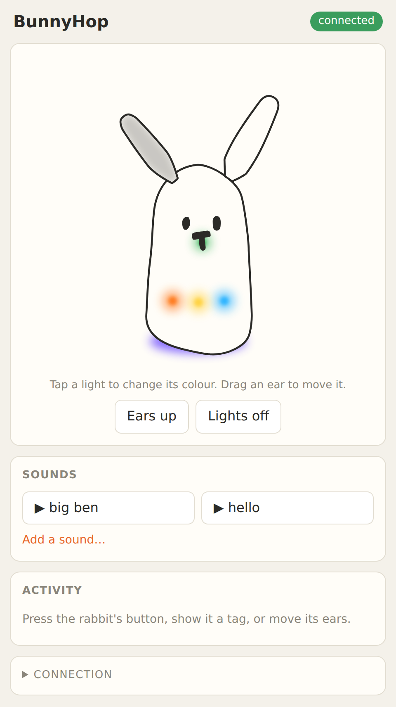

#  BunnyHop

BunnyHop brings a **Nabaztag:tag** - the Wi-Fi rabbit Violet made in 2006 -
back to life with no internet and no cloud servers. An inexpensive ESP32 board sets the
rabbit up, gives it its own Wi-Fi network and talks to it in its original
language. You control the rabbit from a web page on any phone, tablet or
computer, or from your own code.

The rabbit's firmware is never changed. On every boot the rabbit downloads its
program over the network, and BunnyHop serves it Violet's original, unmodified
program, just as Violet's servers once did.

## What you need

- A **Nabaztag:tag** (the second-generation rabbit, with RFID and a microphone).
- An **ESP32 board with 4 MB flash**. Tested with the Adafruit Feather ESP32.

## Get started

1. **Install BunnyHop on the ESP32** from the
   [browser flasher](https://davidchatting.com/BunnyHop/) (Chrome or Edge), or
   with PlatformIO.
2. **Put the rabbit in setup mode**: unplug it, hold the button on its head
   while plugging it back in, and let go when all its lights are blue.
   BunnyHop finds it and configures it, and the rabbit restarts.
3. **Join the rabbit's Wi-Fi** (`Nabaztag` + six characters from the ESP32's
   MAC address, e.g. `Nabaztag3A1F7C`) and open **http://192.168.4.1/**.
4. **Optionally, put it on your home Wi-Fi**: in the web app open
   **Connection → Home Wi-Fi**, press **Scan**, pick your network, enter its
   password and press **Save & connect**. Then rejoin your home Wi-Fi and open
   **http://bunnyhop.local/**.

[docs/SETUP.md](docs/SETUP.md) has the details: installing, first-time setup
and how the networks work.

## Ways to use it



- **The web app.** A live drawing of the rabbit that is also its remote
  control: tap a light to change its colour, drag an ear to move it, play
  sounds, and see button presses, RFID tags and recorded messages as they
  happen. Several people can use it at once.
- **On your home Wi-Fi.** Once BunnyHop is on your home network (step 4
  above), open **http://bunnyhop.local/** from any device on it.
- **From your own code.** `rabbit-api.js` is a small JavaScript client for web
  pages and p5.js sketches:

  ```js
  const rabbit = new RabbitClient();
  rabbit.on('button', () => rabbit.play('/audio/hello.mp3'));
  await rabbit.ears(0, 16);
  await rabbit.leds(['#000', '#f00', '#0f0', '#00f', '#fff']);
  ```

  The WebSocket and REST interface underneath is in [docs/API.md](docs/API.md).
- **Over USB.** Every command also works from the serial console, which is
  handy for development.

More in [docs/USING.md](docs/USING.md).

## Author

BunnyHop was built by [David Chatting](https://github.com/davidchatting) with Claude Code (Claude Opus 5.5); the prompts are logged in [PROMPTS.md](PROMPTS.md).

## Credits

This project stands on years of community work:

- **Violet / Mindscape** - the Nabaztag and its bootcode (by Sylvain Huet et al.).
  The original compiled bootcode served by the bridge (`firmware/data/vl/bootcode.bin`)
  and the bootcode sources consulted in `research/violet-src/` come from the
  OpenJabNab repository below.
- **OpenJabNab** - https://github.com/OpenJabNab/OpenJabNab (GPL-2.0). The XMPP
  dialogue (auth, bind, sources, packet messages), packet formats, message
  obfuscation table, choreography format and LED/ear numbering follow its
  server (`server/lib`, `server/plugins/system`). `bootcode.violet` is from
  `http-wrapper/ojn_local/bootcode/`.
- **ServerlessNabaztag** by andreax79 - https://github.com/andreax79/ServerlessNabaztag
  (no licence stated). Used as a reference for the bootcode's internals (same
  bytecode revision, 21029); no code copied, and its replacement firmware is
  *not* used.
- **ESPAsyncWebServer** and **AsyncTCP** (ESP32Async) - https://github.com/ESP32Async (LGPL-3.0).
- **ArduinoJson** by Benoît Blanchon - https://arduinojson.org (MIT).
- **Arduino-ESP32** / ESP-IDF (Espressif, Apache-2.0) and LittleFS.

## Licence

Copyright (C) 2026 David Chatting.

This project is free software: you can redistribute it and/or modify it under
the terms of the GNU General Public License as published by the Free Software
Foundation, either **version 2 of the License, or (at your option) any later
version** (`GPL-2.0-or-later`). It is distributed in the hope that it will be
useful, but WITHOUT ANY WARRANTY; see [LICENSE](LICENSE) for details.

It is GPL because it redistributes OpenJabNab's copy of the Violet bootcode and
follows OpenJabNab's GPL-2.0 server code closely. Third-party components keep
their own licences (listed above): the firmware links ESPAsyncWebServer and
AsyncTCP (LGPL-3.0), ArduinoJson (MIT) and Arduino-ESP32 (Apache-2.0) - all
compatible with distribution under GPL-3.0, which "or later" permits.
